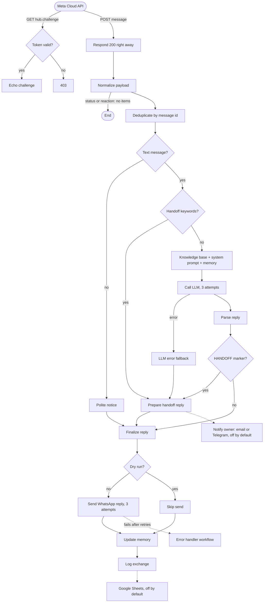

# whatsapp-n8n-llm-starter

Answer WhatsApp Business messages with an LLM using n8n: an importable workflow with short-term memory, human handoff, logging and retries, plus a Docker Compose file and offline tests.

[](https://github.com/Srproxo/whatsapp-n8n-llm-starter/actions/workflows/ci.yml)


The example business is a fictional bakery (*Sunrise Bakery*). Replace one text node with your own business and you have a working first version.

> See also: a complete assistant built as a live demo (fictional data): <https://chatbot.marcelo.ar>

## Features

- **Meta webhook verification** (GET) and **message intake** (POST) on one path; replies 200 immediately.
- Ignores delivery statuses and reactions; **deduplicates** redelivered messages by id.
- Non-text messages (audio, images...) get a polite "please write" notice.
- **Business knowledge base** and **system prompt** are two Set nodes: replace the text, nothing else.
- **Short-term memory** per phone number (last N messages, 24 h).
- **Any OpenAI-compatible LLM** (OpenAI, OpenRouter, Groq, local Ollama) through base URL and model variables; switching to the Anthropic Messages API is documented.
- **Human handoff** by keywords (es / en / pt) or by a marker the LLM emits; optional email or Telegram alert to the owner (disabled by default).
- **Retries** (3 attempts) on every HTTP call, an LLM-failure fallback and a separate **error-handler workflow**.
- **Dry-run mode** and `scripts/simulate.sh` to test with real Meta payload formats without WhatsApp.
- Exchange log in static data, optional Google Sheets log.
- Offline tests and CI; nothing in the repo calls a paid API.

## How it works



More detail in [docs/architecture.md](docs/architecture.md).

## Quick start

Requirements: Docker with Compose, and an LLM endpoint (a provider key, or Ollama running locally).

```bash
git clone https://github.com/Srproxo/whatsapp-n8n-llm-starter.git
cd whatsapp-n8n-llm-starter
cp .env.example .env            # set N8N_ENCRYPTION_KEY, LLM_* (keep WA_DRY_RUN=true)
docker compose up -d
```

1. Open <http://localhost:5678> and create the n8n owner account.
2. Import `workflows/error-handler.json`, then `workflows/whatsapp-llm-assistant.json` (**Workflows > Import from file**).
3. In the main workflow set **Settings > Error workflow** to *WhatsApp LLM Assistant - Error Handler*, and activate both workflows.
4. Simulate Meta without WhatsApp:

   ```bash
   scripts/simulate.sh verify    # webhook handshake, expect the challenge back
   scripts/simulate.sh text      # a customer question
   scripts/simulate.sh human     # asks for a person -> handoff
   scripts/simulate.sh image     # unsupported type
   scripts/simulate.sh status    # delivery status, ignored
   ```

   With the workflow open in the editor and *Listen for test event* active, add `--test`. Check the **Executions** tab.
5. To use real WhatsApp, follow [docs/setup-meta.md](docs/setup-meta.md) and set `WA_DRY_RUN=false`.

## Configuration

All settings are environment variables read by the workflows with `$env`. See [.env.example](.env.example).

| Variable | Purpose |
| --- | --- |
| `N8N_ENCRYPTION_KEY` | Encrypts n8n credentials. Required. |
| `WEBHOOK_URL` | Public base URL of n8n (HTTPS, trailing slash). |
| `N8N_VERSION`, `N8N_HOST`, `N8N_PROTOCOL`, `N8N_SECURE_COOKIE`, `GENERIC_TIMEZONE` | n8n runtime settings. |
| `WA_VERIFY_TOKEN` | String you also enter in Meta's webhook form. |
| `WA_PHONE_NUMBER_ID` | Sender phone number ID from Meta. |
| `WA_ACCESS_TOKEN` | Temporary or System User token. |
| `WA_GRAPH_BASE_URL` | Graph API base URL with version (default `https://graph.facebook.com/v21.0`); point it at the mock for local tests. |
| `WA_DRY_RUN` | `true` logs the reply without calling Meta. |
| `LLM_BASE_URL` | OpenAI-compatible base URL, ending in `/v1` or equivalent. |
| `LLM_API_KEY` | API key (any text for Ollama). |
| `LLM_MODEL` | Model name as the provider spells it. |
| `MEMORY_MESSAGES` | Previous messages sent to the model (default 10, `0` = off). |
| `OWNER_EMAIL`, `SMTP_FROM_EMAIL` | Used if you enable the email notification node. |
| `TELEGRAM_CHAT_ID` | Used if you enable the Telegram notification node. |

How to adapt the business, prompt, model and language: [docs/customize.md](docs/customize.md).

## Project structure

```
workflows/
  whatsapp-llm-assistant.json   main workflow (import this)
  error-handler.json            Error Trigger workflow
scripts/
  simulate.sh                   send example payloads with curl
  fixtures/                     Meta-format payloads (text, image, status, human request, verify)
test/
  helpers/harness.js            runs n8n Code nodes offline
  workflows.test.js             structure, secrets, retries, env docs, compose
  code-nodes.test.js            Code nodes against the fixtures
docs/                           setup-meta, customize, architecture
docker-compose.yml, .env.example
.github/workflows/ci.yml
```

## Testing

```bash
npm test      # Node 22, no dependencies, no network, no API keys
```

The tests validate both workflow files (valid JSON, existing connections, no orphan nodes, triggers present, retries, disabled notifications, placeholder-only credentials, no secret-looking values), confirm every `$env` variable is documented, and run the Code nodes (normalization, deduplication, handoff detection, memory, reply parsing) against the fixtures with a small harness. They do not run n8n itself; for that, import the workflow and use `scripts/simulate.sh`.

## Deploy

- Any host that runs Docker works: put n8n behind a reverse proxy with TLS, set `WEBHOOK_URL`, pin `N8N_VERSION`, use a System User token and `WA_DRY_RUN=false`.
- Back up the `n8n_data` volume and keep `N8N_ENCRYPTION_KEY` safe.
- Read the security notes in [docs/architecture.md](docs/architecture.md) first: the POST webhook does not verify Meta's signature, and memory/dedupe use n8n static data, which suits low volume.

## Costs

This repository is free. Running it is not: the WhatsApp Cloud API is billed by Meta according to its pricing model (per conversation or per message, depending on the current rules, and varying by country and message type), and the LLM is billed by your provider per usage (or your own hardware if you use Ollama). Check both pricing pages before going live. Hosting n8n is a third cost.

## Roadmap

- Verify `X-Hub-Signature-256` through a small front proxy.
- Redis or Postgres for memory and deduplication.
- Reading voice notes (speech-to-text) and images.
- Pause the assistant per chat while a person is talking.

## License

MIT, see [LICENSE](LICENSE). Copyright (c) 2026 Srproxo. Not affiliated with Meta, WhatsApp, n8n or any LLM provider.

## Resumen en español

Kit para responder mensajes de WhatsApp Business con un modelo de lenguaje usando n8n. Incluye un flujo importable con verificación del webhook de Meta, deduplicación, memoria corta por número, llamada a cualquier API compatible con OpenAI (OpenAI, OpenRouter, Groq u Ollama local), derivación a una persona por palabras clave o por marca del modelo, reintentos y un flujo aparte para errores. El negocio de ejemplo es una panadería ficticia: se reemplaza editando dos nodos de texto. Con `docker compose up` y `scripts/simulate.sh` se prueba todo sin WhatsApp real (`WA_DRY_RUN=true`). La guía `docs/setup-meta.md` explica cómo conectar el número en Meta. Los costos de WhatsApp (Meta) y del modelo (el proveedor) son aparte. Demo en vivo de un asistente completo: https://chatbot.marcelo.ar (datos ficticios).

## Resumo em português

Kit para responder mensagens do WhatsApp Business com um modelo de linguagem usando o n8n. Inclui um fluxo importável com verificação do webhook da Meta, deduplicação, memória curta por número, chamada a qualquer API compatível com a OpenAI (OpenAI, OpenRouter, Groq ou Ollama local), encaminhamento para uma pessoa por palavras-chave ou por marca do modelo, novas tentativas e um fluxo separado para erros. O negócio de exemplo é uma padaria fictícia: basta editar dois nós de texto. Com `docker compose up` e `scripts/simulate.sh` dá para testar tudo sem WhatsApp real (`WA_DRY_RUN=true`). O guia `docs/setup-meta.md` mostra como conectar o número na Meta. Os custos do WhatsApp (Meta) e do modelo (o provedor) são separados. Demo ao vivo de um assistente completo: https://chatbot.marcelo.ar (dados fictícios).
