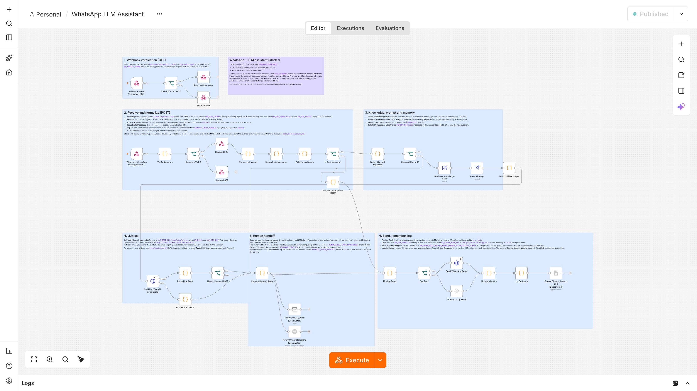
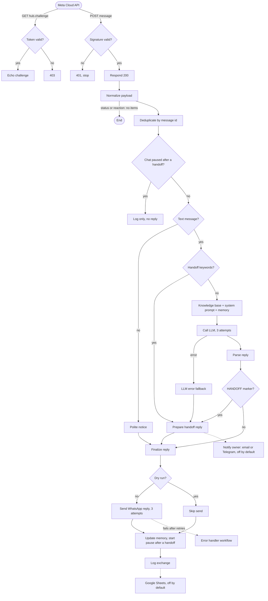

# whatsapp-n8n-llm-starter

Answer WhatsApp Business messages with an LLM using n8n: an importable workflow with signature verification, short-term memory, human handoff with a bot pause, retries and logging, plus local mocks and an end-to-end test that runs it on a real n8n.

[](https://github.com/Srproxo/whatsapp-n8n-llm-starter/actions/workflows/ci.yml)




The example business is a fictional bakery (*Sunrise Bakery*). Replace the text of one node with your own business and you have a working first version.

> See also: a complete assistant built as a live demo (fictional data): <https://chatbot.marcelo.ar>

## What is tested, and how

| Layer | How | Where |
| --- | --- | --- |
| Workflow files | Structure, connections, retries, placeholder-only credentials, secret scan, every `$env` variable documented | `npm test` (60 tests, Node 22, no network) |
| Code nodes | Each Code node runs against Meta-format fixtures in a small harness (`$input`, `$env`, static data, `require('crypto')`, binary helpers) | `npm test` |
| **The real thing** | Both workflows are imported and published into **n8n 2.44.6**, which then talks over HTTP to a mock LLM (`/v1/chat/completions`) and a mock WhatsApp Cloud API. 16 checks, listed under [Testing](#testing) | `npm run test:e2e`, CI job `e2e` |

The e2e job runs on every push. It needs no account and no API key and costs nothing: only `127.0.0.1` is contacted. Not covered: Meta's real servers, a real LLM provider, the Docker image itself (CI validates `docker-compose.yml`; the e2e test runs the npm package of the same n8n version), and the optional email, Telegram and Google Sheets nodes, which ship disabled.

## Features

- **Webhook verification** (GET) and **message intake** (POST) on one path.
- **`X-Hub-Signature-256` check**: HMAC-SHA256 of the raw body with your app secret, compared in constant time. A wrong or missing signature gets `401` and nothing else runs. Live without a secret, every POST is refused.
- Replies `200` right after the signature check, before any LLM work, so Meta does not retry.
- Ignores delivery statuses and reactions; **deduplicates** redelivered messages by id.
- Non-text messages (audio, images...) get a polite "please write" notice.
- **Business knowledge base** and **system prompt** are two Set nodes: replace the text, nothing else.
- **Short-term memory** per phone number (last N messages, 24 h).
- **Any OpenAI-compatible LLM** (OpenAI, OpenRouter, Groq, local Ollama) through base URL and model variables; switching to the Anthropic Messages API is documented.
- **Human handoff** by keywords (es / en / pt), by a marker the model emits, or when the LLM fails 3 times. Afterwards the bot **stays silent in that chat** for `HANDOFF_PAUSE_MINUTES` so it does not talk over the person. Optional email or Telegram alert to the owner.
- **Retries** (3 attempts) on every HTTP call and a separate **error-handler workflow**, wired automatically when imported with the CLI.
- **Local mocks** of the LLM and of the Cloud API send endpoint; `scripts/simulate.sh` sends signed Meta payloads.

## How it works



More detail in [docs/architecture.md](docs/architecture.md).

## Quick start

Requirements: Docker with Compose, Node 22+ and openssl. No WhatsApp number and no LLM key are needed for this first run: the workflow talks to the two local mocks.

```bash
git clone https://github.com/Srproxo/whatsapp-n8n-llm-starter.git
cd whatsapp-n8n-llm-starter
cp .env.example .env
sed -i.bak \
  -e "s#^N8N_ENCRYPTION_KEY=.*#N8N_ENCRYPTION_KEY=$(openssl rand -hex 24)#" \
  -e 's#^LLM_BASE_URL=.*#LLM_BASE_URL=http://host.docker.internal:4010/v1#' \
  -e 's#^WA_GRAPH_BASE_URL=.*#WA_GRAPH_BASE_URL=http://host.docker.internal:4020/v21.0#' \
  -e 's#^WA_DRY_RUN=.*#WA_DRY_RUN=false#' .env && rm .env.bak

# Mocks on the host; HOST=0.0.0.0 lets the n8n container reach them
HOST=0.0.0.0 npm run mock:llm > mock-llm.log 2>&1 &
HOST=0.0.0.0 npm run mock:whatsapp > mock-whatsapp.log 2>&1 &

# n8n with both workflows imported and published
docker compose up -d
docker compose exec n8n n8n import:workflow --separate --input=/workflows
docker compose exec n8n n8n publish:workflow --id=waLlmAssistErrH1
docker compose exec n8n n8n publish:workflow --id=waLlmAssistMain1
docker compose restart n8n
until [ "$(curl -s -o /dev/null -w '%{http_code}' localhost:5678/webhook/whatsapp)" = 403 ]; do sleep 2; done

# Act as Meta (requests are signed with WA_APP_SECRET from .env)
scripts/simulate.sh verify    # webhook handshake: prints the challenge
scripts/simulate.sh text      # a customer question
scripts/simulate.sh human     # asks for a person: handoff reply, chat paused
scripts/simulate.sh image     # unsupported type: polite notice
scripts/simulate.sh status    # delivery status: ignored

curl -s http://localhost:4020/__messages   # what "WhatsApp" received
```

Open <http://localhost:5678>, create the owner account and look at **Executions**. Stop the mocks with `kill %1 %2` (same shell) or `pkill -f scripts/mock-`.

Next steps:

1. Use a real model: set `LLM_BASE_URL`, `LLM_API_KEY` and `LLM_MODEL` (OpenAI, OpenRouter, Groq or Ollama, see [docs/customize.md](docs/customize.md)), then `docker compose up -d`.
2. Put your business in the **Business Knowledge Base** node.
3. Connect a real number with [docs/setup-meta.md](docs/setup-meta.md): `WA_GRAPH_BASE_URL` back to `https://graph.facebook.com/v21.0`, your app secret in `WA_APP_SECRET`.

If you import from the editor (**Workflows > Import from file**) instead of the CLI, n8n assigns new ids: pick *WhatsApp LLM Assistant - Error Handler* under **Settings > Error workflow** of the main workflow.

No Docker? `npm run test:e2e` (Node 24) runs the same workflows on a throwaway n8n with the mocks and prints the result of every check.

## Configuration

All settings are environment variables read by the workflows with `$env`. See [.env.example](.env.example).

| Variable | Purpose |
| --- | --- |
| `N8N_ENCRYPTION_KEY` | Encrypts n8n credentials. Required. |
| `N8N_WEBHOOK_URL` | Public base URL of n8n (HTTPS, trailing slash). |
| `N8N_VERSION` | n8n image tag, pinned to `2.44.6`, the version the e2e test runs. |
| `N8N_HOST`, `N8N_PROTOCOL`, `N8N_SECURE_COOKIE`, `GENERIC_TIMEZONE` | n8n runtime settings. |
| `WA_VERIFY_TOKEN` | String you also enter in Meta's webhook form. |
| `WA_APP_SECRET` | App secret used to check `X-Hub-Signature-256`. Required when `WA_DRY_RUN=false`. |
| `WA_PHONE_NUMBER_ID` | Sender phone number ID from Meta. |
| `WA_ACCESS_TOKEN` | Temporary or System User token. |
| `WA_GRAPH_BASE_URL` | Graph API base URL with version (default `https://graph.facebook.com/v21.0`); point it at the mock for local tests. |
| `WA_DRY_RUN` | `true` skips the send, and the signature when no secret is set. For quick local experiments only. |
| `LLM_BASE_URL` | OpenAI-compatible base URL, ending in `/v1` or equivalent. |
| `LLM_API_KEY` | API key (any text for Ollama and the mock). |
| `LLM_MODEL` | Model name as the provider spells it. |
| `MEMORY_MESSAGES` | Previous messages sent to the model (default 10, `0` = off). |
| `HANDOFF_PAUSE_MINUTES` | Minutes the bot stays silent in a chat after a handoff (default 60, `0` = off). |
| `OWNER_EMAIL`, `SMTP_FROM_EMAIL` | Used if you enable the email notification node. |
| `TELEGRAM_CHAT_ID` | Used if you enable the Telegram notification node. |

`docker-compose.yml` also sets `N8N_BLOCK_ENV_ACCESS_IN_NODE=false` (the workflows read `$env`) and `NODE_FUNCTION_ALLOW_BUILTIN=crypto` (the signature check).

## Security

- **Signature**: every POST must carry a valid `X-Hub-Signature-256` (HMAC-SHA256 of the raw body with `WA_APP_SECRET`, compared with `crypto.timingSafeEqual`). Invalid requests get `401` before parsing, deduplication or any LLM call, so a leaked URL cannot be used to spend your LLM budget. With `WA_DRY_RUN=false` and no secret, the workflow fails closed.
- **Verification token** protects the GET handshake; the challenge is echoed only for `hub.mode=subscribe` and a non-empty matching token.
- **Secrets** live in `.env` (git-ignored) or in n8n credentials. Workflow files hold variable names and placeholder credential names only; a test fails if anything looks like a key.
- **Prompt injection**: the prompt tells the model to ignore instructions in customer messages, but a prompt is not a security boundary. The assistant has read-only knowledge and no tools, which limits what an injection can do.
- **Privacy**: executions store message text and phone numbers; compose prunes them after 7 days.

Details and failure behavior: [docs/architecture.md](docs/architecture.md).

## Project structure

```
workflows/
  whatsapp-llm-assistant.json   main workflow (40 nodes)
  error-handler.json            Error Trigger workflow
scripts/
  mock-llm.mjs                  OpenAI-compatible mock (deterministic answers, handoff marker, failures)
  mock-whatsapp.mjs             Cloud API send mock (checks token and body, records messages)
  simulate.sh                   send signed Meta payloads with curl
  fixtures/                     Meta-format payloads (text, image, status, human request, verify)
test/
  e2e.mjs                       real n8n + mocks, 16 checks
  helpers/harness.js            runs n8n Code nodes offline
  workflows.test.js             structure, wiring, secrets, retries, env docs, compose
  code-nodes.test.js            Code nodes against the fixtures
docs/                           setup-meta, customize, architecture, workflow.png
docker-compose.yml, .env.example
.github/workflows/ci.yml        unit tests (Node 22) + e2e (Node 24, n8n 2.44.6)
```

## Testing

```bash
npm test           # unit tests: Node 22+, no dependencies, no network
npm run test:e2e   # real n8n: Node 24 (required by n8n 2.x)
```

`npm run test:e2e` installs n8n 2.44.6 once into the system temp folder (a few minutes the first time; set `N8N_BIN` to use an existing binary), imports and publishes both workflows into a throwaway instance, starts both mocks and checks over HTTP:

1. GET verification with the right token returns the challenge.
2. GET verification with a wrong token gets 403.
3. POST with a wrong or missing signature gets 401 and is not processed.
4. A delivery status: 200, no LLM call, no reply.
5. A text message: the LLM answer reaches the WhatsApp mock (token, phone number id and body checked).
6. The same message id again: no second reply.
7. A follow-up: the previous exchange is sent to the model as memory.
8. An image: the "text only" notice, no LLM call.
9. `scripts/simulate.sh` requests are accepted (its signature matches n8n's check).
10. A keyword handoff: fixed reply, no LLM call, chat paused for 60 minutes.
11. A message in the paused chat: no reply, logged as `paused`.
12. The model answers with `[[HANDOFF]]`: its sentence is sent and the chat is paused.
13. The LLM returns 500: exactly 3 attempts, then the handoff fallback reply.
14. The WhatsApp send fails: the execution errors and the error-handler workflow runs.
15. Four messages at once: all four get their reply.
16. No other execution failed.

Execution status and static data are read from n8n's SQLite file with `node:sqlite`.

## Limitations

- **State is last-write-wins.** Deduplication, memory, pauses and the log live in n8n workflow static data, which n8n loads when an execution starts and saves whole when it ends. Overlapping executions overwrite each other's updates: in the e2e burst of four simultaneous messages every customer got the right reply, but only one of the four memory updates survived. Limiting n8n's concurrency does not help, because static data is loaded before the execution queue. Fine for low volume; for real traffic move this state to Redis or Postgres.
- **No early end to a pause.** The bot resumes when `HANDOFF_PAUSE_MINUTES` runs out; there is no "resume now" command yet.
- Text only: voice notes and images get a notice, not an answer.
- Replies are free-form text, so they only work inside WhatsApp's 24-hour customer-service window; templates are not handled.
- Static data only persists for published (active) workflows, not for manual runs in the editor.

## Deploy

- Any host that runs Docker works: put n8n behind a reverse proxy with TLS, set `N8N_WEBHOOK_URL`, keep `N8N_VERSION` pinned, set `WA_APP_SECRET`, use a System User token and `WA_DRY_RUN=false`.
- Before upgrading n8n, run `N8N_VERSION=<new version> npm run test:e2e`.
- Back up the `n8n_data` volume and keep `N8N_ENCRYPTION_KEY` safe.

## Costs

This repository and its tests are free. Running it in production is not: Meta bills the WhatsApp Cloud API according to its current pricing (it varies by country and message type), and your LLM provider bills per usage (or your own hardware with Ollama). Check both pricing pages before going live. Hosting n8n is a third cost.

## Roadmap

- Redis or Postgres for memory, deduplication and pauses (atomic updates).
- A command or webhook to end a handoff pause early.
- Voice notes (speech-to-text) and images.
- WhatsApp message templates for replies outside the 24-hour window.

## License

MIT, see [LICENSE](LICENSE). Copyright (c) 2026 Srproxo. Not affiliated with Meta, WhatsApp, n8n or any LLM provider.

## Resumen en español

Kit para responder mensajes de WhatsApp Business con un modelo de lenguaje usando n8n. El flujo verifica la firma `X-Hub-Signature-256` de Meta, descarta duplicados, guarda memoria corta por número, llama a cualquier API compatible con OpenAI y deriva a una persona por palabras clave, por una marca del modelo o si el modelo falla; después de derivar, el bot se calla en ese chat durante `HANDOFF_PAUSE_MINUTES`. Incluye simuladores locales del modelo y de la API de WhatsApp, y una prueba de punta a punta que importa los flujos en un n8n 2.44.6 real y verifica 16 casos en cada push, sin cuentas ni costos. El negocio de ejemplo es una panadería ficticia: se reemplaza editando un nodo de texto. Límite conocido: el estado vive en los datos estáticos de n8n, que pierden actualizaciones cuando llegan mensajes simultáneos; para mucho tráfico conviene Redis o Postgres. Demo en vivo de un asistente completo: https://chatbot.marcelo.ar (datos ficticios).

## Resumo em português

Kit para responder mensagens do WhatsApp Business com um modelo de linguagem usando o n8n. O fluxo verifica a assinatura `X-Hub-Signature-256` da Meta, descarta duplicadas, guarda memória curta por número, chama qualquer API compatível com a OpenAI e encaminha para uma pessoa por palavras-chave, por uma marca do modelo ou quando o modelo falha; depois do encaminhamento, o bot fica em silêncio naquela conversa durante `HANDOFF_PAUSE_MINUTES`. Inclui simuladores locais do modelo e da API do WhatsApp e um teste de ponta a ponta que importa os fluxos num n8n 2.44.6 real e verifica 16 casos a cada push, sem contas nem custos. O negócio de exemplo é uma padaria fictícia: basta editar um nó de texto. Limite conhecido: o estado fica nos dados estáticos do n8n, que perdem atualizações quando chegam mensagens simultâneas; para muito tráfego, use Redis ou Postgres. Demo ao vivo de um assistente completo: https://chatbot.marcelo.ar (dados fictícios).
