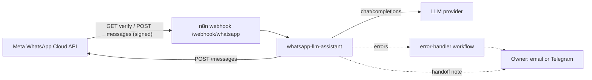

# Architecture

Two small n8n workflows, no custom server.

For local runs and CI, `scripts/mock-llm.mjs` stands in for the LLM provider and `scripts/mock-whatsapp.mjs` for the Cloud API (`WA_GRAPH_BASE_URL`).

## Main workflow stages

| # | Stage | Nodes | Notes |
| --- | --- | --- | --- |
| 1 | Verification | Webhook GET, *Is Verify Token Valid?*, *Respond Challenge* / *Respond 403* | Echoes `hub.challenge` only if mode is `subscribe` and the token equals a non-empty `WA_VERIFY_TOKEN`. |
| 2 | Authentication | Webhook POST (raw body on), *Verify Signature*, *Signature Valid?*, *Respond 200* / *Respond 401* | HMAC-SHA256 of the raw body with `WA_APP_SECRET`, constant-time compare. 200 is sent here, before any slow work. |
| 3 | Intake | *Normalize Payload*, *Deduplicate Messages*, *Skip Paused Chats* | Statuses and reactions yield zero items. Paused numbers are logged and dropped. |
| 4 | Routing | *Is Text Message?* | Non-text goes to a polite notice. |
| 5 | Handoff check | *Detect Handoff Keywords*, *Keyword Handoff?* | Regexes in es / en / pt, before any LLM cost. |
| 6 | Prompt | *Business Knowledge Base*, *System Prompt*, *Build LLM Messages* | Two Set nodes hold all business text. History comes from static data. |
| 7 | LLM | *Call LLM (OpenAI-compatible)*, *Parse LLM Reply*, *Needs Human (LLM)?* | 3 attempts, 2 s apart. The error output goes to *LLM Error Fallback*. |
| 8 | Handoff | *Prepare Handoff Reply*, *Notify Owner (Email / Telegram)* | Notifications are disabled and `continueRegularOutput`, so they never block the reply. |
| 9 | Reply | *Finalize Reply*, *Dry Run?*, *Send WhatsApp Reply* | One convergence point for every path. |
| 10 | Record | *Update Memory*, *Log Exchange*, *Google Sheets: Append Log* (disabled) | *Update Memory* also starts the handoff pause. |

### Item shape through the flow

*Verify Signature* passes on `{ body, signatureValid }` and drops the raw-body copy. `Normalize Payload` emits `{ messageId, from, name, type, text, timestamp, phoneNumberId, lang }`. Every later Code node carries these fields forward and adds `handoff`, `handoffReason`, `reply`, `kind` (`bot`, `handoff`, `unsupported`). Because the HTTP nodes replace the item with the API response, nodes after them read the context back with `$('Build LLM Messages').item.json` or `$('Finalize Reply').item.json` (paired items; verified on n8n 2.44.6 by the e2e test).

## State kept in static data

`$getWorkflowStaticData('global')` is a small JSON object saved with the workflow:

| Key | Content | Bound |
| --- | --- | --- |
| `seen` | message id -> first seen time | 24 h, 2000 ids |
| `memory` | number -> `[{role, content, ts}]` | 40 messages per number, 500 numbers, 24 h used |
| `paused` | number -> time the bot may answer again | `HANDOFF_PAUSE_MINUTES` per entry; expired entries removed on the next handoff |
| `log` | last exchanges, including messages skipped during a pause (`kind: "paused"`) | 200 entries |

Limits to know:

- Static data is **only persisted by published (active) executions**, not by manual runs from the editor.
- **It is last-write-wins.** n8n reads the whole object when an execution starts and writes it back whole when the execution ends, if a node changed it. Two executions that overlap in time therefore overwrite each other's changes. Measured on n8n 2.44.6 (e2e test, four signed messages sent at the same moment with a 300 ms mock LLM): all four customers got the right reply, but only one memory update survived. Consequences: a lost memory turn, a log entry, a dedupe id (a later redelivery of that message would be answered again), or, in the worst case, a handoff pause written by one execution and overwritten by another that started before it finished.
- `N8N_CONCURRENCY_PRODUCTION_LIMIT=1` does **not** fix it: the workflow runner loads static data before the execution enters the concurrency queue (checked in the n8n 2.44.6 source and with the e2e burst).
- For low volume (a small business, messages seconds apart) this is acceptable. For real traffic move `seen`, `memory` and `paused` to Redis or Postgres, where each update is atomic (`SET NX` for dedupe, one row per number), using n8n's Redis or Postgres nodes.

## Security notes

- **Webhook signature.** The POST webhook keeps the raw body (*Raw Body* option, exposed to the Code node as binary property `data`). *Verify Signature* computes `sha256=` + HMAC-SHA256(`WA_APP_SECRET`, raw bytes) and compares it with `X-Hub-Signature-256` using `crypto.timingSafeEqual` (after a length check). The raw bytes matter: Meta escapes non-ASCII characters (`¿`), so re-serializing the parsed JSON would not reproduce the signed body; a unit test covers that case. A bad or missing signature is answered with `401` and the execution stops before normalization, deduplication or the LLM, so knowing the URL is not enough to spend LLM money.
- **Fail closed.** With `WA_DRY_RUN=false` and no `WA_APP_SECRET`, `signatureValid` is `false` for every request. Only dry-run mode without a secret skips the check, for quick local experiments.
- The Code node needs Node's `crypto` module: `NODE_FUNCTION_ALLOW_BUILTIN=crypto` (set in `docker-compose.yml`).
- **Verification token** protects only the GET handshake, which reveals nothing but the challenge.
- Secrets live in environment variables (`.env`, never committed) or in n8n credentials. The workflow files contain only variable names and credential names.
- Workflows read configuration with `$env`, which needs `N8N_BLOCK_ENV_ACCESS_IN_NODE=false`. Any workflow on that instance can then read the environment, so do not share the instance with untrusted workflow authors.
- Prompt injection: the system prompt tells the model to ignore instructions inside customer messages, but a prompt is not a security boundary. The assistant only has read-only knowledge and cannot take actions, which limits the damage.
- **Privacy**: executions store message text and phone numbers. The compose file prunes executions after 7 days; adjust to your legal needs and tell your customers how their messages are processed.

## Failure behavior

| Failure | What happens |
| --- | --- |
| Wrong or missing signature | `401`, nothing processed, no LLM call. |
| Live without `WA_APP_SECRET` | Every POST gets `401` (fail closed). |
| LLM returns an error or times out | 3 attempts, then *LLM Error Fallback*: the customer gets the handoff message, the owner is notified (if enabled), the chat is paused. |
| LLM returns an empty answer | Treated as a handoff (`empty_llm_reply`). |
| WhatsApp send fails | 3 attempts, then the execution fails and the *Error Handler* workflow runs. Memory, pause and log are not updated for a reply the customer never got. |
| Notification fails | Ignored (`continueRegularOutput`); the customer reply is not affected. |
| Meta redelivers a webhook | Dropped by *Deduplicate Messages* (see the static data limit above). |
| Customer writes during a handoff pause | No reply; the message is logged as `paused`. |
| Customer sends audio / image | Bilingual notice asking for text. |

## Why these choices

- **Answer 200 right after the signature check.** Meta retries deliveries that are slow or fail, and an LLM can take several seconds. Checking the signature first costs a few milliseconds and lets forged requests get a real `401`.
- **OpenAI-compatible HTTP node instead of a provider-specific node.** One node covers many providers, the model is a variable, and the same node can point at the local mock.
- **Handoff keywords before the LLM.** Complaints and "I want a person" do not need a paid call, and are not left to model judgment.
- **A pause after handoff.** Without it the bot keeps answering while a person is trying to help, which reads as the business talking over itself.
- **Environment variables for configuration.** The same exported JSON works on any instance, including the throwaway one in the e2e test.
- **Fixed workflow ids.** `settings.errorWorkflow` can point at the error handler, so a CLI import needs no manual wiring.
- **Code nodes are plain JavaScript** with `crypto` as the only module, so they run under n8n's task runner and in the offline harness (`test/helpers/harness.js` emulates `$input`, `$json`, `$env`, `$('Node')`, static data, `require` and `this.helpers.getBinaryDataBuffer`).

## Tests

- `npm test` (Node 22, no dependencies, no network): workflow structure (connections, orphans, triggers, retries, disabled notifications, placeholder credentials, secret-looking strings, fixed ids, tags), that every `$env` variable is documented, the compose file and its pinned version, and every Code node against the fixtures in `scripts/fixtures/`, including signature checks over Meta-escaped raw bytes.
- `npm run test:e2e` (Node 24): the real n8n 2.44.6 runtime with both workflows imported by the CLI and published, against the two mocks. It covers what the harness cannot: node parameter schemas (IF v2, Set 3.4, HTTP Request 4.2 with its error output, Respond to Webhook), expression evaluation, `$env` access, the task runner with `crypto` and binary data, static data persistence between executions and the error-workflow wiring. The scenarios are listed in the README.
- Not covered: Meta's servers, real LLM providers, the Docker image (only `docker compose config` runs in CI), and the disabled email, Telegram and Google Sheets nodes, which need real credentials to execute.
