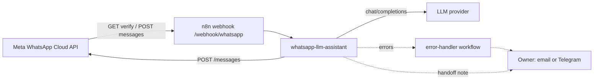

# Architecture

Two small n8n workflows, no custom server.

## Main workflow stages

| # | Stage | Nodes | Notes |
| --- | --- | --- | --- |
| 1 | Verification | Webhook GET, *Is Verify Token Valid?*, *Respond Challenge* / *Respond 403* | Echoes `hub.challenge` only if mode is `subscribe` and the token equals a non-empty `WA_VERIFY_TOKEN`. |
| 2 | Intake | Webhook POST, *Normalize Payload*, *Deduplicate Messages* | Webhook answers 200 on receipt. Statuses and reactions yield zero items. |
| 3 | Routing | *Is Text Message?* | Non-text goes to a polite notice. |
| 4 | Handoff check | *Detect Handoff Keywords*, *Keyword Handoff?* | Regexes in es / en / pt, before any LLM cost. |
| 5 | Prompt | *Business Knowledge Base*, *System Prompt*, *Build LLM Messages* | Two Set nodes hold all business text. History comes from static data. |
| 6 | LLM | *Call LLM (OpenAI-compatible)*, *Parse LLM Reply*, *Needs Human (LLM)?* | 3 attempts, 2 s apart. Failure output goes to *LLM Error Fallback*. |
| 7 | Handoff | *Prepare Handoff Reply*, *Notify Owner (Email / Telegram)* | Notifications are disabled and `continueRegularOutput` so they never block the reply. |
| 8 | Reply | *Finalize Reply*, *Dry Run?*, *Send WhatsApp Reply* | One convergence point for every path. |
| 9 | Record | *Update Memory*, *Log Exchange*, *Google Sheets: Append Log* (disabled) | |

### Item shape through the flow

`Normalize Payload` emits `{ messageId, from, name, type, text, timestamp, phoneNumberId, lang }`. Every later Code node carries these fields forward and adds `handoff`, `handoffReason`, `reply`, `kind` (`bot`, `handoff`, `unsupported`). Because the HTTP nodes replace the item with the API response, nodes after them read the context back with `$('Build LLM Messages').item.json` or `$('Finalize Reply').item.json`.

## State kept in static data

`$getWorkflowStaticData('global')` is a small JSON object saved with the workflow:

| Key | Content | Bound |
| --- | --- | --- |
| `seen` | message id -> first seen time | 24 h, 2000 ids |
| `memory` | number -> `[{role, content, ts}]` | 40 messages per number, 500 numbers, 24 h used |
| `log` | last exchanges | 200 entries |

Limits to know:

- Static data is **only persisted by active (production) executions**, not by manual runs from the editor.
- It is not transactional. Two messages processed at the same moment may overwrite each other's update. For low-volume use this is acceptable; for real traffic move memory and dedupe to Redis or Postgres (n8n has nodes for both).
- It lives inside n8n's database and grows with the numbers it has seen; the caps above keep it small.

## Security notes

- **Verification token** protects only the GET handshake. The POST endpoint is protected by the secrecy of its URL.
- **Signature (`X-Hub-Signature-256`) is not verified.** Meta signs the exact raw body; reproducing those bytes inside a Code node is unreliable, so this starter does not pretend to. If the endpoint is public and costs matter, put a reverse proxy in front that checks the HMAC with your app secret, or move intake to a small service that does. Anyone who learns the URL could otherwise trigger LLM calls.
- Secrets live in environment variables (`.env`, never committed) or in n8n credentials. The workflow files contain only variable names and credential names.
- Prompt injection: the system prompt tells the model to ignore instructions inside customer messages, but a prompt is not a security boundary. The assistant only has read-only knowledge and cannot take actions, which limits the damage.
- **Privacy**: executions store message text and phone numbers. The compose file prunes executions after 7 days; adjust to your legal needs and tell your customers how their messages are processed.

## Failure behavior

| Failure | What happens |
| --- | --- |
| LLM returns an error or times out | 3 attempts, then *LLM Error Fallback*: customer gets the handoff message, owner is notified (if enabled). |
| LLM returns an empty answer | Treated as a handoff (`empty_llm_reply`). |
| WhatsApp send fails | 3 attempts, then the execution fails and the *Error Handler* workflow runs. Memory and log are not updated for a reply the customer never got. |
| Notification fails | Ignored (`continueRegularOutput`); the customer reply is not affected. |
| Meta redelivers a webhook | Dropped by *Deduplicate Messages*. |
| Customer sends audio / image | Bilingual notice asking for text. |

## Why these choices

- **Respond 200 first.** Meta retries deliveries that are slow or fail; an LLM can take several seconds.
- **OpenAI-compatible HTTP node instead of a provider-specific node.** One node covers many providers, and the model is a variable.
- **Handoff keywords before the LLM.** Complaints and "I want a person" do not need a paid call, and are not left to model judgment.
- **Environment variables for configuration.** The same exported JSON works on any instance.
- **Code nodes are plain JavaScript without external modules**, so they run under n8n's sandbox and in the offline tests (`test/helpers/harness.js` emulates `$input`, `$json`, `$env`, `$('Node')` and static data).

## Tests

`npm test` (Node 22, no dependencies, no network) checks: workflow structure (connections, orphans, triggers, retries, disabled notifications, placeholder credentials, secret-looking strings), that every `$env` variable is documented, the compose file, and runs each Code node against the fixtures in `scripts/fixtures/`.

Not covered by tests: the real n8n runtime (node parameter schemas and expression evaluation), Meta's servers and any LLM provider. Import the workflow in n8n and run `scripts/simulate.sh` for that.
